# Antigravity Chinesizing v3.0 Pro 深度全量汉化工程技术规格书

本文档详细记录 **Antigravity Chinesizing v3.0 Pro**（ASAR 原生内嵌汉化旗舰工程）的架构设计、核心功能、底层原理、文件清单与运维指南。

---

## 一、 项目定位与核心功能

### 1. 项目定位
`antigravity-chinesizing-v3-pro` 是一套专为 **Google Antigravity (v2.29.0+)** 打造的生产级、工业化全界面深度汉化套件。它采用直接修改 Electron `app.asar` 主进程与渲染层生命周期的原生内嵌路线，旨在提供 **100% 保持官方原生深浅色视觉风格、零后台常驻进程负担、零点击崩溃风险** 的极致本地化体验。

### 2. 核心功能特性
- **全界面高纯度汉化（3,340+ 精确词条 + 51 条正则规则）**：
  - 覆盖常规设置、智能体权限、存储配额、快捷键、模型列表、技能与规则管理、MCP 服务器中心、PDF 阅读器、内置浏览器及所有错误提示。
  - 正则规则动态覆盖相对时间（如 `3m ago`、`2d ago`）、思考时间（`Thinking for 12s`）、应用设置标题（`Manage Google Calendar app settings.`）等动态拼接句式，杜绝硬编码穷举。
- **主进程与操作系统原生菜单 100% 汉化**：
  - **右键菜单与三点操作菜单**：通过在主进程 `ipcHandlers.js` 的 `buildContextMenuTemplate` 中挂载词典翻译器，彻底攻克了传统 DOM 观察器无法汉化的系统级原生右键菜单（`Copy`、`Pin conversation`、`Delete` 等）。
  - **系统托盘与原生对话框**：汉化任务栏系统托盘（`无正在运行的智能体`、`N 个智能体正在运行`、`新建窗口`、`退出`）以及原生退出确认弹窗（`确认退出`、`确定要退出 Antigravity 吗？`）。
  - **应用顶部菜单与更新状态**：汉化 `Docs`、`Connect to WSL`、`Reopen Locally` 及自动更新提示。
- **Base UI 受控组件多候选反向索引（`REVERSE_INDEX`）**：
  - 构建了 3,075 组一对多反向候选映射，拦截 `Map.prototype.has` 与 `Map.prototype.get`，彻底解决同义翻译词在 React / Base UI 下拉选择框中的状态失灵与死锁问题。
- **免重启实时热重载（CDP Hot Reload）**：
  - 部署脚本完成后，自动通过 Chrome DevTools Protocol 向当前运行中的所有窗口页面注入最新词典与执行器，实现无需重启客户端立即看到汉化效果。
- **自动版本感知与一键无损还原**：
  - 自动识别客户端版本升级（通过检查 `app.asar` 头部是否含补丁标记），升级后自动刷新 `app.asar.bak`；随时可通过一键脚本完整恢复官方纯净英文包。

---

## 二、 架构思路与核心设计哲学

1. **零常驻开销原则（Zero Background Daemon）**：
   不采用开机自启后台 Node.js 守护进程或每秒轮询端口的外挂做法，汉化逻辑完全融入 Electron 自身生命周期，关闭窗口或退出后系统 0 内存占用。
2. **原生视觉保真原则（Visual Fidelity）**：
   不强加任何暖黄色背景、特殊字体或个人审美滤镜，完整呈现 Google 官方设计师打磨的现代高科技质感（完美支持官方深色模式与浅色模式）。
3. **数据与逻辑严格解耦原则（Decoupled Storage）**：
   纯静态词条存放在 `i18n_data.json`，DOM 遍历与代理拦截逻辑封装在 `i18n_runner.js`，打包注入脚本由 `deploy_chinese.py` 驱动，任何一方更新互不干扰。
4. **受控组件绝对安全原则（Safe Controlled Components）**：
   在现代 React 应用中，UI 显示的文本如果直接被 DOM 替换，而组件状态机读取的是内部 `Map<EnglishKey, Value>`，会引发严重的状态失步。我们通过多候选反向代理桥接，使得“界面看到的是中文，底层状态机读取的依旧是正确的英文”。

---

## 三、 底层关键技术原理深度剖析

```mermaid
flowchart TD
    subgraph HostInit["1. 安装与构建阶段 (deploy_chinese.py)"]
        A["读取 resources/app.asar.bak 纯净原版"] --> B["解包至临时沙箱 sandbox/"]
        B --> C["注入主进程 utils.js, main.js, ipcHandlers.js, tray.js, menu.js, updater.js"]
        C --> D["复制 i18n_runner.js 与 i18n_data.json 到 dist/"]
        D --> E["静态语法门禁: 对所有修改文件执行 node --check"]
        E -->|失败 退出码!=0| F["立刻中止并抛错, 保护生产包"]
        E -->|通过| G["重新打包为 app.asar 并原子替换"]
        G --> H["通过 CDP DevToolsActivePort 端口通知当前窗口执行热重载"]
    end

    subgraph RuntimeExec["2. 客户端运行态生命周期 (utils.js & main.js)"]
        I["客户端启动 / 窗口创建"] --> J["app.on('web-contents-created') 全局拦截"]
        J --> K["hubContents.on('dom-ready' / 'did-finish-load') 局部挂载"]
        K --> L["读取 dist/i18n_data.json 与 i18n_runner.js 注入渲染层"]
        L --> M["构建 window.__ANTIGRAVITY_REVERSE_INDEX__ 反向索引"]
        M --> N["代理 Map.prototype.has/get 保护 Base UI 下拉框"]
        N --> O["启动 MutationObserver 仅监听 childList 增量扫描翻译"]
    end

    subgraph NativeIPC["3. 原生右键菜单 IPC 拦截 (ipcHandlers.js)"]
        P["用户在页面右键点击或点击三点图标 (⋮)"] --> Q["前端发送 window:show-context-menu IPC 请求"]
        Q --> R["ipcHandlers.js 调用 buildContextMenuTemplate(items)"]
        R --> S["直接调用 translateAntigravityText(item.label) 翻译成中文"]
        S --> T["调用 Electron Menu.buildFromTemplate 渲染操作系统原生菜单"]
    end
```



### 1. 突破 v2.29.0+ `WebContentsView` (`hubContents`) 容器迁移
- **挑战**：新版 Electron 弃用了旧版 `win.webContents` 承载主界面，改用 `BaseWindow` 并在其内部挂载 `WebContentsView`（命名为 `hubContents`）。旧版钩子挂在 `win.webContents.setWindowOpenHandler` 上将永远无法触发。
- **实现**：在 `dist/utils.js` 中同时挂载 `hubContents.on('dom-ready')` 与 `win.webContents.on('dom-ready')`，并在顶层导出 `injectAntigravityI18n` 函数，该函数自动通过 `getHubWebContents(target)` 解析出正确的 WebContents 句柄。

### 2. 多候选反向索引（`REVERSE_INDEX`）
- **挑战**：单值反向映射 `reverse_map[zh] = en` 存在致命缺陷：当多个不同英文词条翻译为同一个中文时（如 `"Default"` 与 `"Default (Mendel)"` 均翻译为 `"默认"`），会导致单值覆盖。当 Base UI 的受控组件拿 `"默认"` 去查时，如果返回了错误的英文 Key，组件内部 `Map.has(key)` 就会返回 `false`，导致下拉框选择项高亮丢失或无法切换。
- **实现**：在 `i18n_runner.js` 初始化时，自动聚合 `reverse_map` 与 `exact` 生成一对多数组：
  ```javascript
  // 结构示例：
  window.__ANTIGRAVITY_REVERSE_INDEX__["默认"] = ["Default", "Default (Mendel)"];
  ```
  在拦截 `Map.prototype.has(key)` 时，遍历所有候选 Key，并调用原生 `origHas.call(this, candidate)` 实测当前具体的 `Map` 实例真正持有着哪一个英文 Key；若实测存在则立刻返回 `true`。同理，`Map.prototype.get` 也返回匹配候选值。

### 3. 原生菜单主进程与渲染进程双端协同拦截
- **主进程根治**：在 `dist/ipcHandlers.js` 的 `buildContextMenuTemplate` 中，直接在菜单模板构建前对 `item.label` 执行 `translateAntigravityText(item.label)`。
- **渲染进程瞬时兼容**：由于热重载时主进程可能尚未重启，`i18n_runner.js` 监听页面的 `contextmenu`、`pointerdown` 事件，开启一个 120ms 的瞬时 Hook 窗口代理 `Array.prototype.map`，拦截前端在发送 IPC 消息前构建的菜单数组；120ms 后自动恢复原生 `Array.prototype.map`，既实现免重启即时看到右键中文，又保证平时 0 性能损耗。

---

## 四、 详细文件清单与职责说明

```text
d:\my_project\chinese_localization_antigrivaty\antigravity-chinesizing-v3-pro\
├── README.md                      # 项目快速使用总览文档
├── PROJECT_DETAIL.md              # [当前文件] 深度技术规格与架构剖析文档
├── docs/
│   └── architecture_and_comparison.md # 演进历程与详细技术对比报告
├── scripts/
│   ├── deploy_chinese.py          # 核心部署脚本（解包/补丁/语法门禁/打包/CDP热重载）
│   ├── restore_original.py        # 核心还原脚本（原子恢复官方 app.asar.bak）
│   ├── i18n_runner.js             # 渲染层执行器（反向索引/DOM扫描/菜单瞬时拦截）
│   └── i18n_data.json             # 词典数据（3340+ exact / 54 reverse / 51 regex）
├── tools/
│   └── extract_ui_strings.mjs     # 运行态 CDP 前端 Bundle 提取与词库覆盖率审计工具
└── skills/
    └── Chinesizing/
        └── SKILL.md               # 沉淀至智能体知识库的 Electron 桌面端汉化工程规范
```

### 文件代码逻辑细解：

| 文件路径 | 编程语言 | 核心代码逻辑与职责说明 |
| :--- | :--- | :--- |
| [`scripts/deploy_chinese.py`](file:///d:/my_project/chinese_localization_antigrivaty/antigravity-chinesizing-v3-pro/scripts/deploy_chinese.py) | Python 3 | 1. 自动探测系统资源路径（Windows `%LOCALAPPDATA%` / macOS `/Applications` / Linux `/opt`）；<br/>2. 检查 `target_asar` 是否被修改，若为官方新版则刷新 `app.asar.bak`；<br/>3. 解包纯净备份到临时目录，向 `utils.js`、`main.js`、`tray.js`、`menu.js`、`updater.js`、`ipcHandlers.js` 注入补丁；<br/>4. 对所有修改的 7 个 JS 文件执行 `node --check` 语法门禁；<br/>5. 调用 `@electron/asar pack` 原子打包并写回生产环境；<br/>6. 读取 `DevToolsActivePort` 端口，通过 WebSocket 向当前活动页面注入热更新。 |
| [`scripts/i18n_runner.js`](file:///d:/my_project/chinese_localization_antigrivaty/antigravity-chinesizing-v3-pro/scripts/i18n_runner.js) | JavaScript (ES6) | 1. 初始化 `window.__ANTIGRAVITY_REVERSE_INDEX__` 多候选反向索引表；<br/>2. 挂载 `Map.prototype.has` 与 `Map.prototype.get` 拦截器；<br/>3. 实现 `isInsideExcluded` 过滤规则（收缩排除范围，仅跳过代码块、终端与可编辑区，严防误伤普通 UI）；<br/>4. 挂载 120ms 瞬时 `Array.prototype.map` 拦截器翻译原生菜单项；<br/>5. 实现 `MutationObserver` 监听 `childList`，纯值比对自愈翻译 TextNode 与属性（`placeholder`、`title`、`aria-label`、`alt`）。 |
| [`scripts/i18n_data.json`](file:///d:/my_project/chinese_localization_antigrivaty/antigravity-chinesizing-v3-pro/scripts/i18n_data.json) | JSON | 包含 `exact`（3,340 项）、`reverse_map`（54 项受控组件选项）、`regex_rules`（51 项动态匹配正则）和 `exemptions`（白名单忽略项）。 |
| [`scripts/restore_original.py`](file:///d:/my_project/chinese_localization_antigrivaty/antigravity-chinesizing-v3-pro/scripts/restore_original.py) | Python 3 | 检测是否存在 `app.asar.bak` 与 `app.asar.bak.unpacked`，执行安全覆盖还原，彻底恢复官方原状。 |
| [`tools/extract_ui_strings.mjs`](file:///d:/my_project/chinese_localization_antigrivaty/antigravity-chinesizing-v3-pro/tools/extract_ui_strings.mjs) | Node.js (ESM) | 自动通过活跃的 CDP 调试通道获取运行中 Antigravity 完整前端 React Bundle（约 10.67 MB），利用正则静态提取所有 UI 字符串属性（`label`、`title`、`description` 等），并自动与 `i18n_data.json` 比对覆盖率。 |

---

## 五、 操作与运维指南

### 1. 汉化部署
在终端运行：
```powershell
python d:\my_project\chinese_localization_antigrivaty\antigravity-chinesizing-v3-pro\scripts\deploy_chinese.py
```
或直接在工作区根目录双击 **`一键汉化.bat`**。
- **现象**：终端将打印环境检测、语法校验通过（7 files verified）、打包替换成功以及活跃窗口热重载成功的提示，当前打开的客户端界面会实时变成中文。
- **生效说明**：DOM 界面与右键菜单即刻生效；系统托盘菜单与退出确认对话框需要彻底在右下角托盘点击“退出”后重新打开客户端生效。

### 2. 官方原版还原
在终端运行：
```powershell
python d:\my_project\chinese_localization_antigrivaty\antigravity-chinesizing-v3-pro\scripts\restore_original.py
```
或直接在工作区根目录双击 **`一键还原官方英文.bat`**。

### 3. 未来新版本词库覆盖率自动化审计
当 Antigravity 发布大版本升级时，保持客户端运行并执行：
```powershell
node d:\my_project\chinese_localization_antigrivaty\antigravity-chinesizing-v3-pro\tools\extract_ui_strings.mjs
```
脚本将输出总提取词条数、当前词典覆盖率百分比，并将未翻译的新增词条清单打印出来，便于针对性补齐。
