# Antigravity Chinese Localization v3.0 Pro (企业级全量深度汉化套件)

<p align="center">
  <strong>专为 Google Antigravity (Electron) 打造的高性能、全生命周期持久化、零后台进程负担的深度全界面汉化方案</strong>
</p>

<p align="center">
  
  
  
  
  
</p>

---

## 🌟 核心亮点 (v3.0 Pro 突破性特性)

1. **零外部守护进程，纯净原生保真 (Zero Background Daemon)**：
   - 不依赖任何开机自启常驻后台的 Node.js 轮询进程，零系统内存负担；
   - 100% 保持 Google 原厂深浅色主题质感，不强加个人审美滤镜，不篡改默认字体。
2. **深度适配 Antigravity v2.29.0+ 新架构**：
   - 完美适配新版 Electron `BaseWindow` + `WebContentsView` (`hubContents`) 窗口容器；
   - 解决通用事件假命中导致的幂等跳过缺陷，刷新、跳转、新建窗口均 100% 持久生效。
3. **主进程与操作系统原生菜单 100% 汉化**：
   - **原生右键菜单与会话三点菜单 (`⋮`)**：直接在主进程 `ipcHandlers.js` 的 `buildContextMenuTemplate` 中拦截翻译，攻克了传统 DOM 观察器无法汉化原生菜单的世纪难题；
   - **系统托盘与退出弹窗**：系统托盘菜单（运行智能体数、打开、新建窗口、退出）与原生退出确认对话框全面中文呈现。
4. **Base UI 受控组件多候选反向索引 (`REVERSE_INDEX`) 保护**：
   - 建立 3,075 组一对多反向映射，通过 `Map.prototype.has/get` 实测当前组件实例持有的英文 Key，彻底根除同义词在下拉框中引发的选择失效与死锁。
5. **免重启实时热重载 (Live CDP Hot-Reload)**：
   - 部署完成后自动通过 Chrome DevTools Protocol 向当前活动窗口推送最新词典与执行器，免重启即刻看到汉化效果。
6. **自动化语法门禁与版本自感知**：
   - 打包前强制对修改的 7 个文件执行 `node --check` 门禁自检，退出码非 0 绝不写入生产包；
   - 自动识别客户端官方版本升级，升级后自动刷新 `app.asar.bak` 纯净备份。

---

## 🤖 面向 AI Agent 的一键部署指令 (Agent Prompt)

如果您正在使用 Antigravity 或 Cursor / Windsurf / Claude Code 等 AI 编程助手，**只需将以下提示词直接复制发送给智能体**，Agent 将全自动完成无损部署与验证：

### 📋 复制以下提示词发送给 AI Agent：
```text
请帮我根据本项目对当前的 Google Antigravity 客户端进行企业级全量中文汉化部署：
1. 请阅读并遵循项目内的规范文档 skills/Chinesizing/SKILL.md 与 PROJECT_DETAIL.md；
2. 运行 python scripts/deploy_chinese.py 执行沙箱注入、语法门禁校验 (node --check) 与原子 ASAR 替换；
3. 确保当前活动界面的 CDP 热重载成功生效，并在完成后向我汇报汉化结果与后续使用建议。
```

> **提示**：如果您的智能体联网克隆了远程仓库，也可以直接对 Agent 运行：
> `请阅读 https://github.com/qworkhard/antigravity-chinese-locale-pro 中的 Chinesizing 技能并执行本地化部署。`

---

## 🚀 人工手动快速安装指南

### 方式一：双击一键批处理（最推荐）
直接双击项目根目录下的 **`一键汉化.bat`**。
脚本将自动检测环境、执行解包、语法门禁、打包替换与当前窗口热重载。

### 方式二：终端命令行执行
确保本地已安装 Python 3.8+ 及 Node.js 18+（系统环境变量含 `python` 与 `node`）：
```powershell
# 1. 部署汉化
python scripts/deploy_chinese.py

# 2. 如需一键还原为官方纯净英文版
python scripts/restore_original.py
# 或双击：一键还原官方英文.bat
```

---

## 🛠️ 项目文件结构

```text
antigravity-chinesizing-v3-pro/
├── 一键汉化.bat                     # 便捷启动批处理（双击部署）
├── 一键还原官方英文.bat             # 便捷还原批处理（双击无损还原）
├── README.md                        # [当前文件] 项目总览与 Agent 提示词
├── PROJECT_DETAIL.md                # 深度技术规格书（架构/原理/代码职责）
├── LICENSE                          # MIT 开源协议 (Copyright 2026 qworkhard)
│
├── docs/
│   └── architecture_and_comparison.md # 深度架构演进与社区方案横向对比报告
│
├── scripts/
│   ├── deploy_chinese.py            # 主进程/渲染层双端注入与热重载部署引擎
│   ├── restore_original.py          # 纯净备份原子还原引擎
│   ├── i18n_runner.js               # 渲染层执行器 (REVERSE_INDEX / 菜单瞬时拦截)
│   └── i18n_data.json               # 核心双语词库 (3340+ exact / 54 reverse / 51 regex)
│
├── tools/
│   └── extract_ui_strings.mjs       # 运行态 CDP 前端 Bundle 提取与词库覆盖率审计工具
│
└── skills/
    └── Chinesizing/
        └── SKILL.md                 # 供 AI Agent 学习的 Electron 桌面汉化规范与 12 大教训
```

---

## 🔬 架构与底层工作流

```mermaid
flowchart TD
    subgraph Host["1. 部署阶段 (deploy_chinese.py)"]
        A["读取 resources/app.asar.bak 纯净原版"] --> B["解包至临时沙箱 sandbox/"]
        B --> C["注入主进程 utils.js, main.js, ipcHandlers.js, tray.js, menu.js, updater.js"]
        C --> D["复制 i18n_runner.js 与 i18n_data.json 到 dist/"]
        D --> E["静态语法门禁: 对所有修改文件执行 node --check"]
        E -->|失败| F["中止并抛错, 保护生产包"]
        E -->|通过| G["打包为 app.asar 并原子替换"]
        G --> H["通过 CDP 调试端口向活动窗口推送热更新"]
    end

    subgraph Runtime["2. 运行态 (Electron 主进程 + 渲染进程)"]
        I["客户端启动 / 窗口打开"] --> J["app.on('web-contents-created') 全局拦截"]
        J --> K["hubContents 挂载 dom-ready 注入执行器"]
        K --> L["构建 REVERSE_INDEX 代理 Map.prototype.has/get"]
        L --> M["ipcHandlers.js 在主进程原生翻译右键菜单与 ⋮ 菜单"]
        M --> N["MutationObserver 监听 childList 高性能翻译 DOM 界面"]
    end
```



---

## ❓ 常见问题 (FAQ)

**Q1: 汉化后关闭窗口，从桌面再次双击打开变回英文了？**  
**A**：Antigravity 默认勾选了“常驻系统托盘 / 后台运行”。点击窗口右上角“X”只是关闭了窗口，旧的主进程仍在内存中常驻。请在右下角任务栏系统托盘找到 Antigravity 图标，右键选择 **“退出 (Quit)”**，彻底结束进程后重新打开，即可从磁盘加载最新的中文 `app.asar`。

**Q2: 客户端自动更新后汉化失效了怎么办？**  
**A**：Antigravity 自动更新后会用官方新版覆盖 `app.asar`。此时只需再次双击运行 **`一键汉化.bat`**，部署引擎会自动识别出新版并刷新备份，3 秒内即可完成新版本的无损汉化！

**Q3: 如何检查词典对新版本的覆盖率？**  
**A**：保持 Antigravity 客户端运行，在终端执行：
```powershell
node tools/extract_ui_strings.mjs
```
该工具会通过 CDP 实时抓取客户端前端 Bundle 并与词典进行比对，直接输出覆盖百分比及未翻译词条。

---

## 📄 开源许可证

本项目基于 [MIT License](LICENSE) 开源。欢迎 Star、Fork 与提 Issue！
